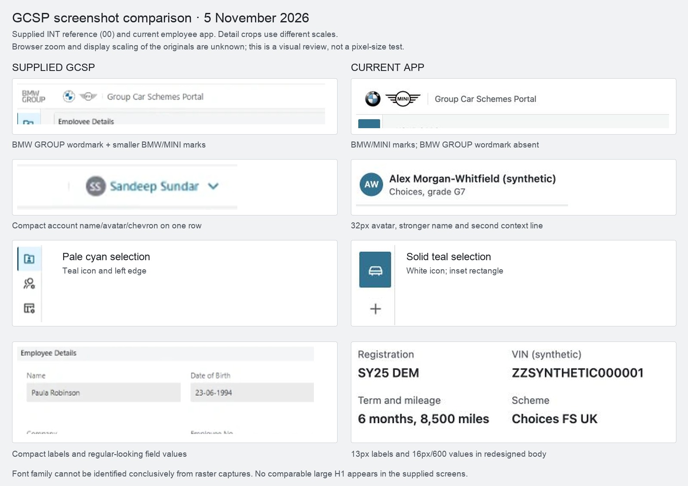

# Comparison with supplied GCSP screenshots

Reviewed 5 November 2026 against the [eight supplied captures](../screens/README.md). **Partial visual match: the palette is consistent, but the current shell is not an exact match and the screenshots do not verify our font-family choices.** The previous [typography audit](README.md#full-typography-audit) verifies deployed RIS/Aftersales Density rules; that is different evidence from matching GCSP itself.

## Findings

| Area | Supplied GCSP | Current application | Assessment |
|---|---|---|---|
| Header branding | BMW GROUP wordmark followed by small BMW/MINI marks and portal title | BMW/MINI marks and title; BMW GROUP wordmark absent | Clear shell difference. Restore the wordmark and review the relative mark/title proportions in the UI pass. |
| Account context | Compact avatar/name/chevron on one row | 32px avatar, 14px/600 name, second 12px context line, no chevron | Different composition and stronger emphasis. The screenshot does not establish the menu's behaviour. |
| Selected navigation | Pale cyan background, teal icon and thin teal left edge; clearest in capture 00 | Solid teal inset rectangle with white icon | Clear mismatch against the agreed selected-state reference. |
| Shell geometry | Visually slim header and narrow icon rail | 56px header, 48px rail, 44px navigation targets | Local geometry choices. Original browser zoom/display scaling is unknown, so image pixels cannot establish the original CSS dimensions. |
| Palette | White/light-grey surfaces, neutral text and teal/cyan accents | Same palette direction, using observed Density tokens | Visually consistent at palette level. Screenshots do not prove exact token equality. |
| Body labels and values | Compact labels and regular-looking values in dense forms/tables | 13px/400 fact labels, 16px/600 values, larger spacing and cards | Visibly different hierarchy. This follows the agreed body redesign; it is not a reproduction of the supplied body. |
| Headings and actions | Small panel headings and compact controls; no comparable standalone large H1 | 34px/500 condensed H1, 24px/600 section headings, 16px/600 primary button text in 48px controls | More prominent hierarchy. The supplied screens cannot validate the condensed H1 choice. |
| Font families | Raster images, without original CSS or font metadata | BMW Group TN Condensed Pro Medium for large H1s; Density's system stack for other app text | Verified against RIS/Aftersales source, **not conclusively identified in these GCSP screenshots**. |

The source captures show Windows/Chrome. A system-font stack can render differently across operating systems. Apparent letter width, weight or size in these raster images is insufficient to identify the exact original family or declare it an exact match. The narrower, lighter-looking supplied text warrants a separate distinction from the verified Density role mapping; it does not justify guessing another font file.

## Scope and evidence

The [binding visual direction](../experience-quality.md#visual-reference) uses these screenshots for the header, sidebar and palette. The consumer-oriented body is deliberately redesigned. The body differences above are therefore not a reason to restore the legacy dense forms, tables or seven-step wizard. Header branding/account composition and selected navigation remain concrete reference gaps for the UI pass.

All eight source images were inspected together, with employee-account and replace-vehicle also inspected at full size and shell/type details enlarged. The composite uses capture 00 for legible examples of the persistent shell and field typography. Crops have different enlargement factors, labelled in the image; they are not a scale-matched overlay. Supplied INT test data is reference content, not a source of employee facts or scheme rules.

Current comparison target: `gcsp-employee.html`, default rendered fixture, at a 1065×1087 CSS pixel viewport. The [current app capture](evidence/gcsp-screenshot-review-current.jpg) and [computed browser styles](evidence/gcsp-screenshot-review-browser.json) record the observed surface. Source revision: `f16c411` (the application typography implementation is `7a3e3fe`).

This request produced a review and evidence only; application code and styling were not changed. The composite was visually inspected and its local document/image links checked. The earlier 188 passing typography checks remain separate implementation evidence, not proof of visual equality with GCSP. No runtime tests were rerun for this documentation-only review.
