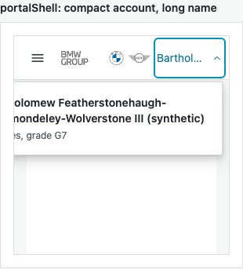
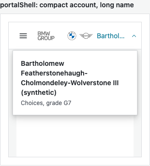
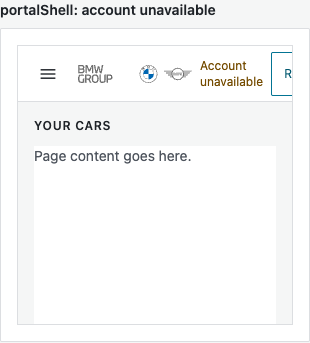
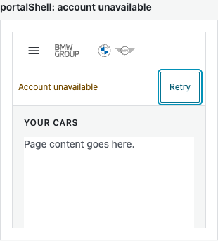

# FUCQ-346 — narrow gallery account containment

The gallery account popup now sizes from its own embedded frame. At narrow frame widths, the unavailable status and Retry share a full header row. The complete long name/context and Retry remain readable at a 390px browser width. The shared live account styles and account controller did not change.

Implementation: `9cc11eb602e77858ee75945544b109fe96dc3c7c`, claim base `7d146fe3dd99766ea2376e54bb6b2c668e1c2f3d`, branch `dev/DEV-2026-11-10-005`. Advanced base `829cf1a9` was merged and pushed in `348fc7691feca61b2d3bc6136b6e8683296c6c47`. The only executable change belonging to FUCQ-346 is `blocks/vehicle-matcher/component-gallery.css`; the existing 93-line ratchet cap remains unchanged. Component ownership is documented in `COMPONENTS.md`.

## Acceptance evidence

| Original criterion | Evidence |
| --- | --- |
| Complete identity/context at 390px | Original base CSS reproduces left clipping with the same current markup/data. Corrected text rectangles and popup fit the embedded frame; the lead and independent reviewer inspected the full long synthetic identity and `Choices, grade G7`. |
| Full Retry and usable loading | Original base CSS reproduces right clipping. Corrected Retry fits, receives pointer and Enter activation, and retains a complete narrow target. Loading stays inside the frame. The gallery fixture supplies no real account loader; existing shell tests cover Retry handler dispatch. |
| Desktop and live menus remain usable | Corrected desktop popup width and header heights equal the baseline. Actual default `mountOffer`/`mountOutbox` shells fit at 1440px and 390px, including open, pending and local failure states. Enter/Escape disclosure and restored focus pass. |
| Scoped regression and independent rendered critique | Initial shell/ratchet checks passed 154/154. The final advanced-base shell/ratchet/narrow account-boundary checks passed 162/162, with no failures or skips. Independent Assessment A inspected all 24 fresh desktop/narrow captures and found no actionable issues. Assessment B completed actual injection on four views; the combined critique is in `review.md` and `validation.json`. |

## Visual comparison

The red cases deliberately use the original base gallery CSS. Both narrow defects were reproduced before assessing the corrected rendering.

| Case | Original base CSS | Corrected CSS |
| --- | --- | --- |
| Long identity, 390px |  |  |
| Unavailable, 390px |  |  |

The `lead/` directory retains all 24 hash-verified screenshots: base/corrected gallery at 1440px and 390px, corrected loading and closed focus, and actual default offer/outbox account menus in open/pending/error states at both widths. Assessment A independently generated and visually inspected all 24, proved them byte-identical, and removed its duplicate directory. `validation.json` records the image hashes and supplied attachment hashes.

## Validation scope

Selected before execution:

```sh
node --test --test-concurrency=1 server/test/gcsp-shell.test.js server/test/ui-ratchet.test.js
```

Strict targeted stamping passed: 154 tests, 0 failed, 0 skipped, 10.216868 seconds. This covers shell disclosure, identity/context, loading/unavailable/Retry wiring, gallery composition and existing stylesheet/component ratchets. The selector's dry-run proposed an unconfigured-language full `npm test` fallback; that broad fallback was reviewed and excluded for this gallery-only CSS change. No full suite ran. The current runner does not supply measured per-test coverage contexts; the impact map combines reviewed ownership and browser boundary evidence without claiming those measurements.

For the dispatcher-requested advanced-base checkpoint, the same command also included `server/test/gcsp-manual-gallery-paging.test.js`: **162/162 passed, 0 failed, 0 skipped, 10.699062 seconds**. The actual incoming diff advances that module's narrow account-name assertion to the shared imported account-menu stylesheet; that concrete boundary justifies including its eight checks. This is separate from FUCQ-348's identity-fixture repair. All `blocks/`, `components.html`, `scripts/` and package inputs match the reviewed implementation, so rendered evidence and independent reviews were reused by hash. The single map conflict was append-only; both FUCQ-346 and FUCQ-348 rows retained their original times and slices.

Browser evidence used an owned static server and fresh isolated headless Chrome contexts, with external requests blocked. It compared original and corrected CSS against the same current gallery data/markup, then mounted the actual default offer/outbox frontends with synthetic read adapters. A locally injected 503 exercised pending/failure layout. These checks prove the frontend layout boundary, not genuine session revocation, live service integration, source, mail, or deployment. No real device, screen reader or cross-browser certification was run. No production or deployed smoke was run.

The supplied attachments `937462`, `937463` and `937464` were viewed by the lead and independent reviewer; their original bytes were preserved. The frozen implementation, source/test hashes, executed helper hashes, scoped stamp, review provenance and cleanup receipt are recorded in `validation.json`.

No new defect was identified within the original acceptance scope. The dispatcher owns final integration, native Jira lifecycle and collaborator acceptance; these local checks do not establish a Done transition.
