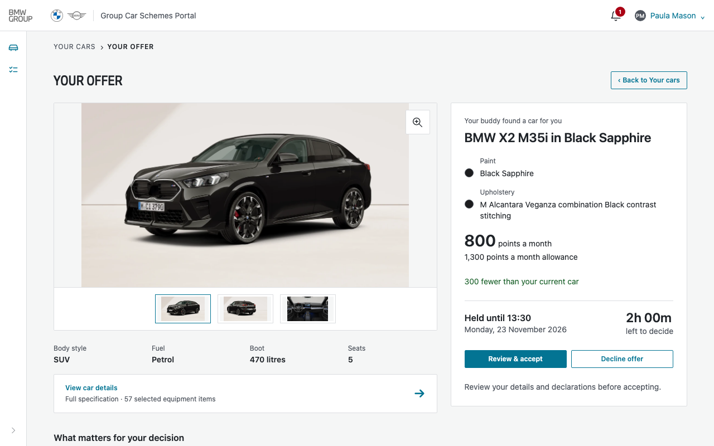
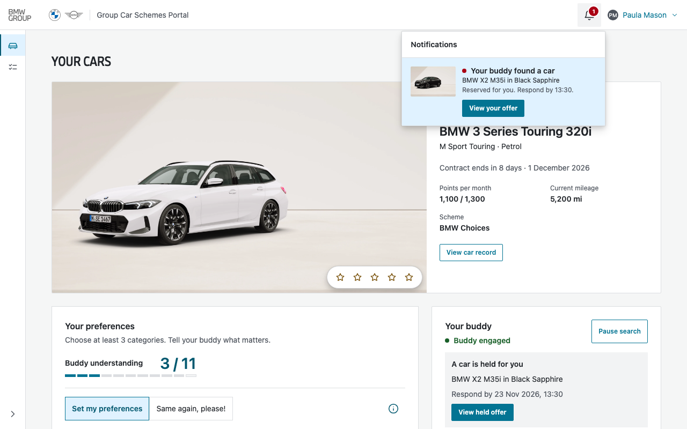
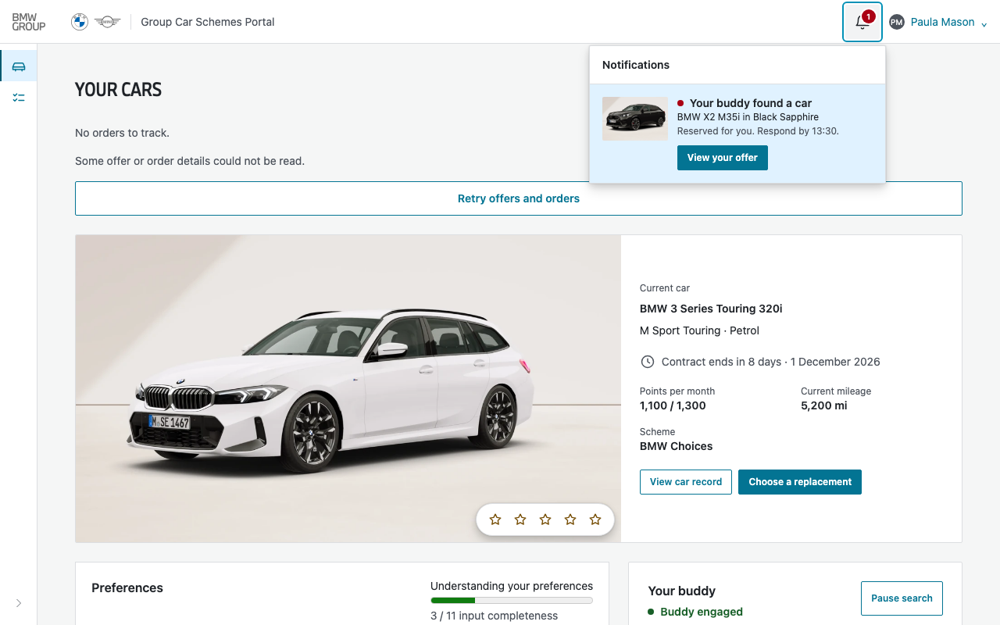

# Offer and bell parity evidence — 23 November 2026

Two original human decisions remain pending: **Offer (FUCQ-555 AC8)** and **Employee notification bell (FUCQ-548 AC6)**. Each can receive its own verdict. No human verdict has been recorded, and neither Bug is accepted. The session is stopped after the requested wind-down; the prepared evidence remains available for human review. No new review chat was started during wind-down.

The latest registered Chromium suite at `c13e604bc4bf3578c1fcf76e9c948fe72e95d09b` passed **12/12 reported tests** across all six F548/F555 compositions, with all seven stage exits zero. Root independently reconciled all 1834 tracked inputs, actual checks/counts, complete dependency identities and current cleanup: `.claude/test-runs/f555-overnight-20261123/final-consolidated-chromium-20261124/root-independent-audit.json` (SHA `2447118a488f7383a8b6cf181c22c9562d18bb1a06719e9b481ca48be51bd6e1`). The test-only correction waits for specification visibility before the unchanged full-text comparison; no product, assertion, normalizer or frozen reference changed. The final WEB shared-cache variant separately passed **1955 cases / 117 specs / 12 serial chunks**; no npm ci is claimed. Root audit SHA `7db8afe706597fde734faa3c6feeb7552318a3e7d5bff614bed45ed09dd78f93` records exact inputs/raw reports and cleanup.

WebKit26.4 at the preceding c22 candidate remains full RED on the separate F548 immutable-reference deadline-copy comparison and a navigation-context error; all five F555 flows passed there. This is not actual Safari proof or a cross-engine green. Latest exact unfiltered Node remains RED:4284 tests/4181 passes/37 failures/66 skips; all37 match the human F555-only report-only decision. Canonical Java45353840595 completed successfully at08:35:45UTC on24November at717148a079, whose full API tree equals c13e and integrated source:371reports/2296cases/2294pass/0failures/errors/2original opt-in skips, all31groups/0unrun. Root inventory/resource audit04d8b7b4 and cleanup79481ad1 reconciled; green batchd4ce61cb7, lease and batch branch/worktree released. RawXML absent; no fresh remote OS/catalogue claim. Original F555AC8/F548AC6 human verdicts remain pending. Historical failures, capture diagnostics and limitations remain in their original receipts.

The scenario and screenshot package below is the retained **23 November** human-review evidence. Its original source/time/provenance stays unchanged; the new runtime receipts above are separate.

## Scenario and provenance

Both sides use the retained, immutable **Main successful journey** initial account/brief/stock inputs and actual release, allocation and hold services. Java's named Main reset remains unavailable (FUCQ-562); the authorised exact-input setup is recorded rather than a successful named reset. Only FUCQ-563's separately recorded predecessor NULL/zero metadata exception remains excluded. No offer, quote, hold or derived outcome was manufactured for a screenshot.

The pending offer and open bell show BMW X2 M35i in Black Sapphire, order UUID `76b834a9-269f-4f4b-b1b0-1361ac211f81`, at **23 November 2026, 11:30 UTC**, clock version 4, held until 13:30. Each case's actual Java and Node offer identifiers, environment, run, clock and source PNG SHA-256 are in [the asset manifest](offer-and-bell-parity-2026-11-23/manifest.json). The cases use independent environment bindings and are paired within each case; deterministic offer identifiers may recur across cases.

## Offer — pending, 1280 × 800 — FUCQ-555 AC8

| Frozen Node reference | Angular / Java |
| --- | --- |
|  |  |

The same pending page's lower comparison table is shown below. This is an element capture at the 1280-wide viewport, not another screen or human decision. Both PNGs have SHA-256 `84c22c104e578b88e37daaa0712fe0d0e36ef28879646e6cb421725ede9e9354`.

| Frozen Node reference | Angular / Java |
| --- | --- |
|  |  |

Agent pre-check: the corrected 96px desktop content inset and horizontal review/decline actions are visible. Long car/upholstery text, swatches, 800 points, 300 saving, date and remaining-time hierarchy are readable. The table identifies both cars and clearly emphasises current-car boot space and offered points as the winning cells. The additional breadcrumb is permitted by `experience-quality.md`.

**Framing remains for human judgment.** Angular loads the approved packaged 1200×675 image (46,310 bytes, `d22f7324…`); frozen Node loads the registered 2560×1646 live variant (104,690 bytes, `a5c465ca…`). Their framing differs. The existing thumbnail-registration ruling does not supply the human verdict on this offer hero.

## Employee bell — one active offer open, 1280 × 800 — FUCQ-548 AC6

| Frozen Node reference | Angular / Java |
| --- | --- |
|  |  |

Agent pre-check: the bell is left of the account menu with red count 1. Its open panel has a readable title, current X2 thumbnail/name, 13:30 deadline and View your offer control. The page behind the bell differs, including Angular's order-read warning; this row covers the original bell screen area and state, with host Account/Orders acceptance remaining separately scoped. The registered thumbnail variants remain explicit in the manifest. FUCQ-566's inherited off-left panel at 375px is separately recorded; it creates no new containment criterion here.

## Supporting technical evidence

The five F548 leaves and five F555 leaves passed; the reported total includes their two parent tests. Actual pending surfaces agree at 1280 and 390. The JVM was stopped and restarted with a different PID/start identity; every retained native quote/offer/hold row and full quote/comparison projection remained equal, including current 1,100 points and offered 800 points.

Both live DOM journals record 2h 00m → **0h 05m with the under-five announcement and enabled decisions** → **Offer expired with decisions absent**, at matching public clocks 13:25/v5 and 13:30/v6. Ordinary expiry did not exhibit the conditional pending-at-zero state; its existing component/store regression evidence is retained.

The actual decision journeys verify Documents jump-link focus, validation-error focus, native checked/selected controls and no early submission. A saved decline changes estate → hatchback exactly once, creates brief version 2 at the authoritative 11:30 clock, then navigates to **Activity HTTP 200** with the declined car, Buddy engaged and “Search updated after a decline”.

- [Offer at 390: Node](offer-and-bell-parity-2026-11-23/offer--pending--390--node.png) · [Angular](offer-and-bell-parity-2026-11-23/offer--pending--390--angular.png)
- [Selected Documents at 1280](offer-and-bell-parity-2026-11-23/documents--selected--1280--angular.png) · [390](offer-and-bell-parity-2026-11-23/documents--selected--390--angular.png)
- [Settled saved-follow-up Activity at 390](offer-and-bell-parity-2026-11-23/activity--saved-followup--390--angular.png)

Lead and independent Pluto review found no new scoped actionable product defect. They inspected the actual desktop/narrow hierarchy, long terms, fixed drawer Close/footer, selected radio/checkbox focus, stages/order identity and settled saved Activity. All 34 capture identities were checked; 30 unique image byte sets were inspected. **This is agent engineering evidence; the two human rows remain blank.**

Limits are retained: top crops and table-only crops do not show the highlight-card bodies or complete 57-item equipment tab. Connected DOM/full-details equality and matching component/style/empty-state evidence cover those parts; no new final pixel inspection of them is claimed. Track-order, support and expired-Activity captures show route arrival/loading, not finished destination-screen acceptance. F548 has real 30-second polling and real reads after synthetic visibility/pageshow signals; physical hidden-to-visible, BFCache restoration and Safari/WebKit remain unproved. The useful saved-follow-up Activity evidence is settled separately.

Root independently verified all 19 browser-owned process identities and groups, owner, native database, registry, scratch and reservations absent; shared PostgreSQL and caches remain. No OneDrive location was accessed. Raw run/readback/review/cleanup evidence is retained locally under `.claude/test-runs/web-e2e/web-e2e-20261123-193939-a053c6/` and `.claude/test-runs/f555-resume-20261123/`.

## Necessary dependency disposition

| Work | Evidence used by this delivery | Remaining boundary |
| --- | --- | --- |
| F548 | Supported global styles/bell; final five leaves and active/expired/keyboard/count/polling evidence | Original AC6 human bell verdict remains pending. Final Java covering is green; exact Node RED/report-only and historical WebKit limitations above remain. |
| F549 | Published shell/navigation/breadcrumb/focus ports used by the actual offer exits | Whole navigation/role-screen acceptance stays with F549. |
| F550 | Published shared refresh registration used by actual signed deadline rereads | Whole refresh acceptance stays with F550. |
| F551 | Published canonical assets, FactList/DataTable and supported Account/Activity ports; actual comparison winners and saved Activity | Whole Account/assets/Activity acceptance stays with F551. |
| F564 | Reviewed run-clock repair, 261 scoped checks and actual strict account/context/offer clock equality | Root owns covering and whole-Bug disposition. |
| F565 | 321 scoped checks; actual 1,100/800/300, native immutable rows and literal JVM restart equality | Root owns covering and remaining whole-Bug disposition. |
| F567 | 63 scoped checks; actual exact owner-offer navigation and preserved count | Root owns covering and native disposition. |
| F568 / F569 | Corrected complete golden specs, 14/14 and 6/6 scoped | Final source WEB covering passed 1,948 cases / 117 specs / 12 fresh chunks. Old 1,942-case green remains historical; native disposition stays root-owned. |
| F570 | 272 scoped checks and final settled saved-follow-up Activity 200 at run time, brief 2 and useful timeline | Root owns covering and native disposition; existing stored future history was not repaired. |

F556's already-published compatible Button and supported Orders route are consumed. Whole Orders, TaskList, SlotPicker and associated screen acceptance remain outside this delivery's prerequisite gate. F562, F563 and F566 remain separately recorded, with the existing narrow rulings above.

## Human verdict ledger

Status: **human review pending; session stopped after technical disposition.** One response can give a separate verdict for each row. The fields below stay blank until a human collaborator gives a cited verdict: `matches`, `differs: <Bug key>` or `intended change: <cited ruling>`. A described difference can be tracked before closure. Any collaborator has equal authority.

| Screen / original criterion | State and viewport | Pair | Verdict | Human reviewer | Date | Source |
| --- | --- | --- | --- | --- | --- | --- |
| Offer — F555 AC8 | Pending held Main X2, 1280 | Top and lower table pairs above | | | | |
| Employee bell — F548 AC6 | Open with one active Main X2, 1280 | Bell pair above | | | | |
