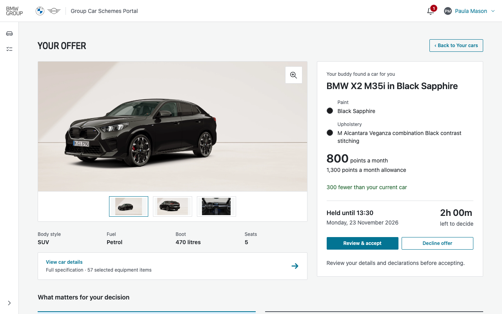
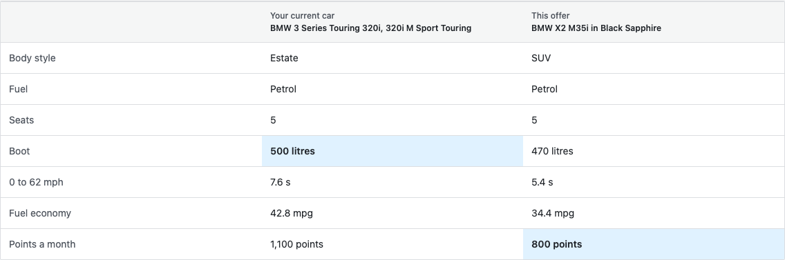
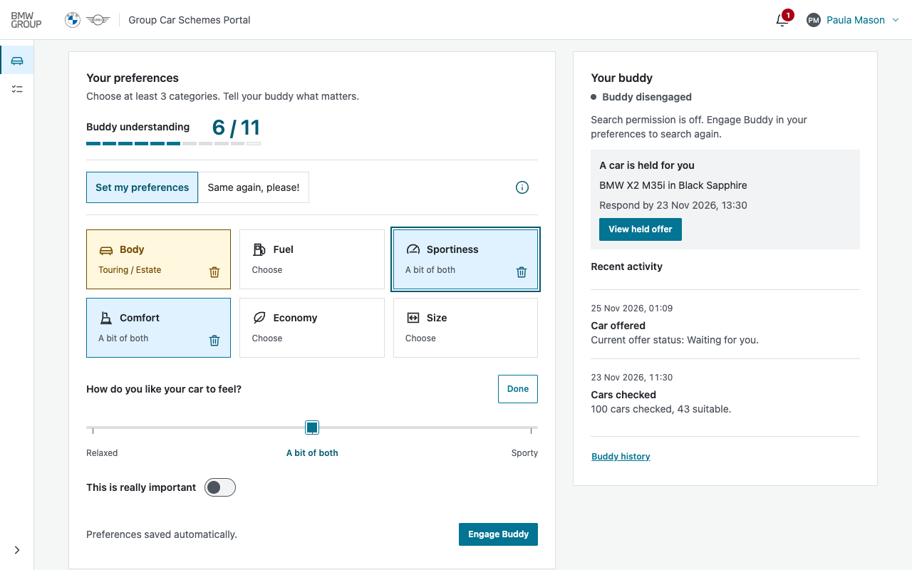
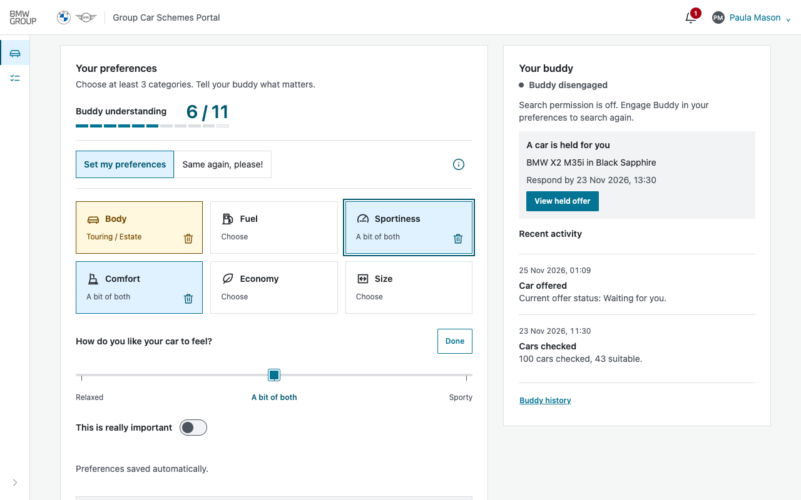
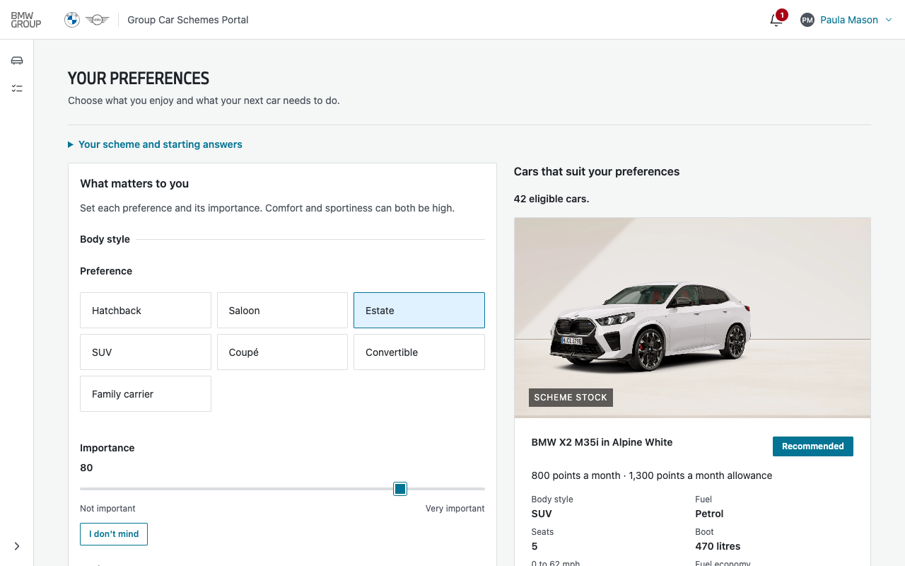
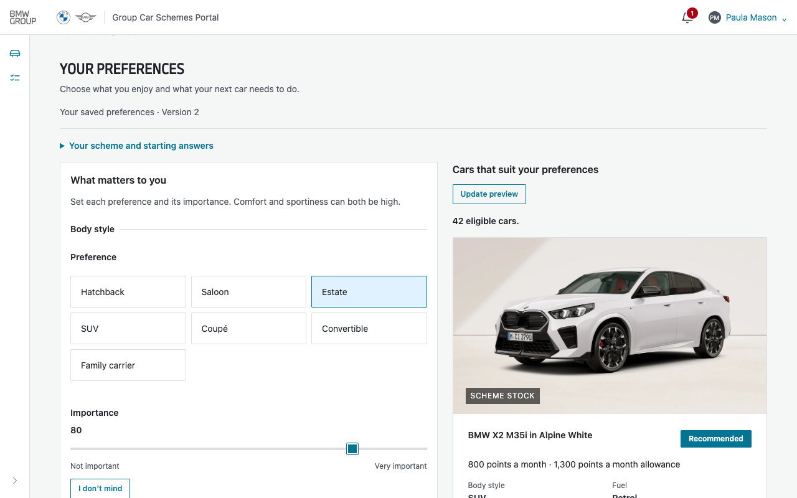
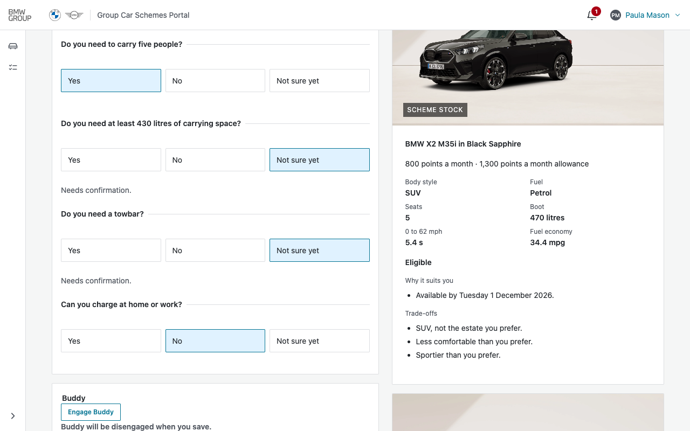
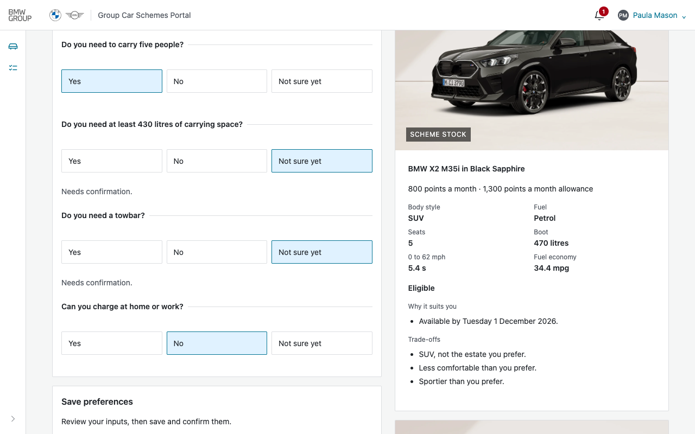
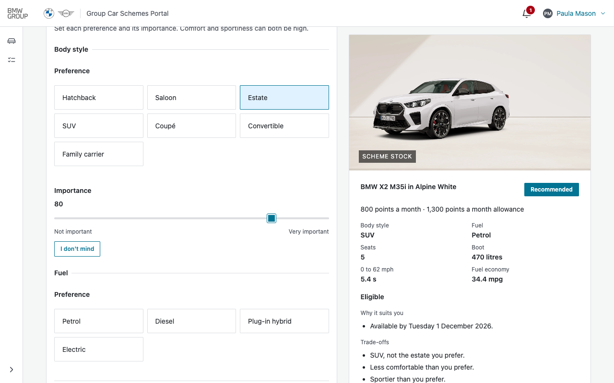
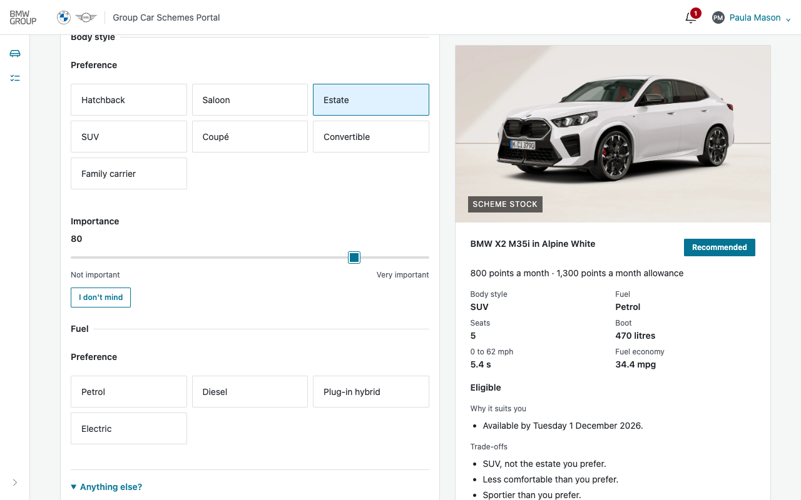

# Offer and bell parity evidence — 23 November 2026

**25 November update:** the combined human review includes the retained Offer (FUCQ-555 AC8) and bell (FUCQ-548 AC6) pairs, Preferences (FUCQ-552 AC7), F549 navigation (AC4), F550 release/update (AC5), and the F551 held-account pair (original AC6). Native issue, comment, filename and attachment-ID pointers appear below; no image copies were added. F549 AC1's control/Activity wording decision remains pending; AC2/3 engineering criteria are met. F550's required human decision is its original release/update pair; the outbox chip comparison is supporting context, not another gate. F562 has since delivered Main reset. Earlier stopped-session/setup notes and retained captures keep their original observation times. All human verdicts remain pending; F551's signed-in hosted journey remains unproved. Combined review thread: `MSG-2026-11-25-sorrel-001`.

The previous wind-down note describes that earlier session; the existing combined thread already points to this artifact. No new review question or thread is created here. No human review or acceptance is claimed, and no Bug is accepted.

The latest registered Chromium suite at `c13e604bc4bf3578c1fcf76e9c948fe72e95d09b` passed **12/12 reported tests** across all six F548/F555 compositions, with all seven stage exits zero. Root independently reconciled all 1834 tracked inputs, actual checks/counts, complete dependency identities and current cleanup: `.claude/test-runs/f555-overnight-20261123/final-consolidated-chromium-20261124/root-independent-audit.json` (SHA `2447118a488f7383a8b6cf181c22c9562d18bb1a06719e9b481ca48be51bd6e1`). The test-only correction waits for specification visibility before the unchanged full-text comparison; no product, assertion, normalizer or frozen reference changed. The final WEB shared-cache variant separately passed **1955 cases / 117 specs / 12 serial chunks**; no npm ci is claimed. Root audit SHA `7db8afe706597fde734faa3c6feeb7552318a3e7d5bff614bed45ed09dd78f93` records exact inputs/raw reports and cleanup.

WebKit26.4 at the preceding c22 candidate remains full RED on the separate F548 immutable-reference deadline-copy comparison and a navigation-context error; all five F555 flows passed there. This is not actual Safari proof or a cross-engine green. Latest exact unfiltered Node remains RED:4284 tests/4181 passes/37 failures/66 skips; all37 match the human F555-only report-only decision. Canonical Java45353840595 completed successfully at08:35:45UTC on24November at717148a079, whose full API tree equals c13e and integrated source:371reports/2296cases/2294pass/0failures/errors/2original opt-in skips, all31groups/0unrun. Root inventory/resource audit04d8b7b4 and cleanup79481ad1 reconciled; green batchd4ce61cb7, lease and batch branch/worktree released. RawXML absent; no fresh remote OS/catalogue claim. Original F555AC8/F548AC6 human verdicts remain pending. Historical failures, capture diagnostics and limitations remain in their original receipts.

The scenario and screenshot package below is the retained **23 November** human-review evidence. Its original source/time/provenance stays unchanged; the new runtime receipts above are separate.

## Scenario and provenance

Both sides use the retained, immutable **Main successful journey** initial account/brief/stock inputs and actual release, allocation and hold services. Java's named Main reset remains unavailable (FUCQ-562); the authorised exact-input setup is recorded rather than a successful named reset. Only FUCQ-563's separately recorded predecessor NULL/zero metadata exception remains excluded. No offer, quote, hold or derived outcome was manufactured for a screenshot.

The pending offer and open bell show BMW X2 M35i in Black Sapphire, order UUID `76b834a9-269f-4f4b-b1b0-1361ac211f81`, at **23 November 2026, 11:30 UTC**, clock version 4, held until 13:30. Each case's actual Java and Node offer identifiers, environment, run, clock and source PNG SHA-256 are in [the asset manifest](offer-and-bell-parity-2026-11-23/manifest.json). The cases use independent environment bindings and are paired within each case; deterministic offer identifiers may recur across cases.

## Offer — pending, 1280 × 800 — FUCQ-555 AC8

| Frozen Node reference | Angular / Java |
| --- | --- |
|  |  |

The same pending page's lower comparison table is shown below. This is an element capture at the 1280-wide viewport, not another screen or human decision. Both PNGs have SHA-256 `84c22c104e578b88e37daaa0712fe0d0e36ef28879646e6cb421725ede9e9354`.

| Frozen Node reference | Angular / Java |
| --- | --- |
|  |  |

Agent pre-check: the corrected 96px desktop content inset and horizontal review/decline actions are visible. Long car/upholstery text, swatches, 800 points, 300 saving, date and remaining-time hierarchy are readable. The table identifies both cars and clearly emphasises current-car boot space and offered points as the winning cells. The additional breadcrumb is permitted by `experience-quality.md`.

**Framing remains for human judgment.** Angular loads the approved packaged 1200×675 image (46,310 bytes, `d22f7324…`); frozen Node loads the registered 2560×1646 live variant (104,690 bytes, `a5c465ca…`). Their framing differs. The existing thumbnail-registration ruling does not supply the human verdict on this offer hero.

## Employee bell — one active offer open, 1280 × 800 — FUCQ-548 AC6

| Frozen Node reference | Angular / Java |
| --- | --- |
|  |  |

Agent pre-check: the bell is left of the account menu with red count 1. Its open panel has a readable title, current X2 thumbnail/name, 13:30 deadline and View your offer control. The page behind the bell differs, including Angular's order-read warning; this row covers the original bell screen area and state, with host Account/Orders acceptance remaining separately scoped. The registered thumbnail variants remain explicit in the manifest. FUCQ-566's inherited off-left panel at 375px is separately recorded; it creates no new containment criterion here.

## Supporting technical evidence

The five F548 leaves and five F555 leaves passed; the reported total includes their two parent tests. Actual pending surfaces agree at 1280 and 390. The JVM was stopped and restarted with a different PID/start identity; every retained native quote/offer/hold row and full quote/comparison projection remained equal, including current 1,100 points and offered 800 points.

Both live DOM journals record 2h 00m → **0h 05m with the under-five announcement and enabled decisions** → **Offer expired with decisions absent**, at matching public clocks 13:25/v5 and 13:30/v6. Ordinary expiry did not exhibit the conditional pending-at-zero state; its existing component/store regression evidence is retained.

The actual decision journeys verify Documents jump-link focus, validation-error focus, native checked/selected controls and no early submission. A saved decline changes estate → hatchback exactly once, creates brief version 2 at the authoritative 11:30 clock, then navigates to **Activity HTTP 200** with the declined car, Buddy engaged and “Search updated after a decline”.

- [Offer at 390: Node](offer-and-bell-parity-2026-11-23/offer--pending--390--node.png) · [Angular](offer-and-bell-parity-2026-11-23/offer--pending--390--angular.png)
- [Selected Documents at 1280](offer-and-bell-parity-2026-11-23/documents--selected--1280--angular.png) · [390](offer-and-bell-parity-2026-11-23/documents--selected--390--angular.png)
- [Settled saved-follow-up Activity at 390](offer-and-bell-parity-2026-11-23/activity--saved-followup--390--angular.png)

Lead and independent Pluto review found no new scoped actionable product defect. They inspected the actual desktop/narrow hierarchy, long terms, fixed drawer Close/footer, selected radio/checkbox focus, stages/order identity and settled saved Activity. All 34 capture identities were checked; 30 unique image byte sets were inspected. **This is agent engineering evidence; the two human rows remain blank.**

Limits are retained: top crops and table-only crops do not show the highlight-card bodies or complete 57-item equipment tab. Connected DOM/full-details equality and matching component/style/empty-state evidence cover those parts; no new final pixel inspection of them is claimed. Track-order, support and expired-Activity captures show route arrival/loading, not finished destination-screen acceptance. F548 has real 30-second polling and real reads after synthetic visibility/pageshow signals; physical hidden-to-visible, BFCache restoration and Safari/WebKit remain unproved. The useful saved-follow-up Activity evidence is settled separately.

Root independently verified all 19 browser-owned process identities and groups, owner, native database, registry, scratch and reservations absent; shared PostgreSQL and caches remain. No OneDrive location was accessed. Raw run/readback/review/cleanup evidence is retained locally under `.claude/test-runs/web-e2e/web-e2e-20261123-193939-a053c6/` and `.claude/test-runs/f555-resume-20261123/`.

## Necessary dependency disposition

| Work | Evidence used by this delivery | Remaining boundary |
| --- | --- | --- |
| F548 | Supported global styles/bell; final five leaves and active/expired/keyboard/count/polling evidence | Original AC6 human bell verdict remains pending. Final Java covering is green; exact Node RED/report-only and historical WebKit limitations above remain. |
| F549 | Published shell/navigation/breadcrumb/focus ports used by the actual offer exits | Whole navigation/role-screen acceptance stays with F549. |
| F550 | Published shared refresh registration used by actual signed deadline rereads | Whole refresh acceptance stays with F550. |
| F551 | Published canonical assets, FactList/DataTable and supported Account/Activity ports; actual comparison winners and saved Activity | Whole Account/assets/Activity acceptance stays with F551. |
| F564 | Reviewed run-clock repair, 261 scoped checks and actual strict account/context/offer clock equality | Root owns covering and whole-Bug disposition. |
| F565 | 321 scoped checks; actual 1,100/800/300, native immutable rows and literal JVM restart equality | Root owns covering and remaining whole-Bug disposition. |
| F567 | 63 scoped checks; actual exact owner-offer navigation and preserved count | Root owns covering and native disposition. |
| F568 / F569 | Corrected complete golden specs, 14/14 and 6/6 scoped | Final source WEB covering passed 1,948 cases / 117 specs / 12 fresh chunks. Old 1,942-case green remains historical; native disposition stays root-owned. |
| F570 | 272 scoped checks and final settled saved-follow-up Activity 200 at run time, brief 2 and useful timeline | Root owns covering and native disposition; existing stored future history was not repaired. |

F556's already-published compatible Button and supported Orders route are consumed. Whole Orders, TaskList, SlotPicker and associated screen acceptance remain outside this delivery's prerequisite gate. F562, F563 and F566 remain separately recorded, with the existing narrow rulings above.

## F549 and F550 — native review evidence added 25 November

These attachment pointers resolve through the existing Jira issues and comments across clones. The screenshots remain attached in Jira; this artifact does not duplicate their image bytes. Frozen Node reference for both comparisons: `e44ed08a9`.

### F549 — navigation — source `65e5f210c` — AC4

Actual connected Node/Angular pairs were captured on 25 November at 1280×800, before deliberate preference changes. Greg is settled at the same no-new-order outcome. Native publication is on FUCQ-549, comment `5067204`:

| Role / state | Angular | Frozen Node |
| --- | --- | --- |
| Greg navigation, same no-new-order outcome | `angular-greg-navigation-1280.png` — attachment `1647050` | `node-greg-navigation-1280.png` — attachment `1647051` |
| Employee navigation, before deliberate preference changes | `angular-employee-navigation-1280.png` — attachment `1647052` | `node-employee-navigation-1280.png` — attachment `1647053` |

The pairs evidence role/account headers, rails, the selected Greg tab and breadcrumbs; body presentation differs. Angular's employee view shows a generic preview banner absent in Node alongside a `/manual/order` 404. The F549 capture retained statuses without bodies, so it did not establish the cause; the later F551 diagnosis tracks the no-false-error boundary. AC2/3 engineering criteria are met. AC1's control/Activity wording decision remains unresolved, and AC4 human review remains unchecked. No account/body repair or parity acceptance is inferred.

### F550 — live release/update — source `4526da931` — AC5

The actual public release updated the original open Your cars tab without employee input, navigation or reload. The 25 November 1280-wide full-page captures show Angular before and after that release and frozen Node in the same-release state. Native publication is on FUCQ-550, comment `5067240`:

| Capture | Native attachment |
| --- | --- |
| Angular account before release; full page anchored at the pre-release fixed-header position | `account-before-public-release-1280.png` — `1647059` |
| Angular account after release; same open tab, with the observed scroll reset | `account-after-public-release-1280.png` — `1647060` |
| Frozen Node, same release | `node-account-same-release-1280.png` — `1647061` |
| Angular outbox after release; supporting current-chip comparison only | `outbox-after-public-release-1280.png` — `1647062` |
| Frozen Node outbox, same release; supporting current-chip comparison only | `node-outbox-same-release-1280.png` — `1647063` |

Engineering evidence at `4526da931` is 5/5 reported tests (four selected groups plus parent); unchanged account/Activity/offer matrices are reused from `cb7e5049a`. This does not claim one full-family green run. The account recovery banner is visible. Its cause was unestablished at this capture; `/manual/order` 404 alone did not establish it. The later F551 diagnosis is recorded separately. The frozen Node outbox has two observed rows versus Angular's one, including an extra historical `renewal-case-update` at 22 November 09:30; its exact pre-release creation boundary was not observed. Only the current-offer chip's label/class/SVG/colour match is established, not full outbox inventory or layout parity. F551 retains the image-source/framing difference for human review and any necessary scoped producer proposal; no framing repair is claimed. F550 AC5 human review remains pending; no acceptance is claimed. These are preserved observations, not added F550 gates.

## F551 — account / held offer — original AC6 — 25 November

The final held-account pair is the original AC6 visual evidence. Native publication is on FUCQ-551, comment `5067309`; no image bytes are copied into this artifact.

| State | Frozen Node | Angular |
| --- | --- | --- |
| Held account, 1280-wide (original AC6 pair) | `node-account-held-1280.png` — attachment `1647092` | `angular-account-held-1280.png` — attachment `1647093` |

Supporting Angular captures provide narrow and additional account states only; they are not extra AC6 criteria:

| State | Capture | Native attachment |
| --- | --- | --- |
| Held account, 390px | `angular-account-held-390.png` | `1647094` |
| Paused account | `angular-account-paused-1280.png` | `1647095` |
| Real read failure and retry | `angular-account-real-read-failure-1280.png` | `1647096` |
| Finished account | `angular-account-finished-1280.png` | `1647097` |

The final capture source is `1eb11b32356f36f7f7a53842bbe21aa65e74a6f0`; its six registered account groups passed in 24.37 seconds with no console errors. The production source is unchanged since `0a6fdcc30`. Actual evidence shows no false warning in the no-orders state; canonical current-offer rows without `runId` lead to pending detail. Pause returned 200; the subsequent public “Same again” autosave returned 200 and preserved both pause and hold; Resume then returned 200. A real aborted read showed the genuine warning and retry recovered; acceptance returned 200, displayed Finished and verified Track order. Runtime states are inferred from unique UI states and envelopes, without private object inspection.

The Node and Angular captures use different image sources and framing (2560×1646 and 1200×675 respectively); photo-source equivalence is not established. Angular's no-orders line is 52px, and preferences, status and details presentation differ. The signed-in hosted journey remains unproved; the separate current-derived asset GET (200, 40,050 bytes) establishes availability only. F551 stays partial / In Progress. AC6 verdict, reviewer, date and source remain blank; no human parity acceptance or framing fix is claimed.

## Human verdict ledger

Status: **human review pending; combined review resumed on 25 November.** One response can give a separate verdict for each row. The fields below stay blank until a human collaborator gives a cited verdict: `matches`, `differs: <Bug key>` or `intended change: <cited ruling>`. A described difference can be tracked before closure. Any collaborator has equal authority.

| Screen / original criterion | State and viewport | Pair | Verdict | Human reviewer | Date | Source |
| --- | --- | --- | --- | --- | --- | --- |
| Offer — F555 AC8 | Pending held Main X2, 1280 | Top and lower table pairs above | matches (Gary: "otherwise they all match") | Gary Carter | 2026-11-25 | Gary Carter, reviewing the committed pairs with the Claude poller; quoted verbatim in reply on `MSG-2026-11-25-sorrel-001` |
| Employee bell — F548 AC6 | Open with one active Main X2, 1280 | Bell pair above | matches (Gary: "otherwise they all match") | Gary Carter | 2026-11-25 | Gary Carter, reviewing the committed pairs with the Claude poller; quoted verbatim in reply on `MSG-2026-11-25-sorrel-001` |
| F549 — AC4 | Greg navigation, same no-new-order outcome, 1280×800 | Greg pair in F549 evidence section | | | | |
| F549 — AC4 | Employee navigation before preference changes, 1280×800 | Employee pair in F549 evidence section | | | | |
| F550 — AC5 | Open Your cars tab across public release, 1280-wide full page | Angular before/after plus frozen Node same-release captures in F550 evidence section; outbox pair is supporting chip evidence only | | | | |
| F551 — AC6 | Held account, 1280-wide | Node attachment `1647092` and Angular attachment `1647093`; supporting states in F551 section | | | | |

## Preferences — F552 AC7 — 25 November review addition

The original seven criteria and ownership remain with FUCQ-552. Its source was merged at `e4341a613` as **partial**, with human AC7 and covering validation pending. Lead and Timone inspected all eleven final captures. The passing registered family reported 6/6 entries across five groups, including save → Activity → actual held-offer acceptance → read-only preferences → Orders; the final covering tests passed24/24 and scoped boundaries7/7. This engineering evidence supplies the pairs, without a human verdict.

The frozen reference is `e44ed08a9674d8bf0fe6de2e7195ec3e2d775d38`; tested Angular/source is `070904ed0303e06cf472fed0c79c0eedb18288a0`, integrated with F562 at `b5bc94a54`. Both use Main successful journey, `main-successful-journey-inputs-v2`, employee Paula, actual clock **23 November2026 11:30UTC**, saved brief2, custom mode and Buddy understanding6/11. Desktop viewport1280×800, Chromium, en-GB/Europe-London, reduced motion. Named regions scroll below the sticky header plus16px; offsets may differ while the named visible states match. [Full provenance and observations](preferences-parity-2026-11-25/README.md) retain the actual inputs, UUID membership and image-source limits.

### Account — Sportiness open, 1280×800

| Frozen Node | Angular / Java |
| --- | --- |
|  |  |

### Editor — ordered categories and axes, 1280×800

| Frozen Node | Angular / Java |
| --- | --- |
|  |  |

### Editor — practical questions, 1280×800

| Frozen Node | Angular / Java |
| --- | --- |
|  |  |

### Editor — first preview card, 1280×800

| Frozen Node | Angular / Java |
| --- | --- |
|  |  |

**Pre-check / existing Bug ownership:** unresolved editor/card observations remain under **F552 AC7**. Angular's saved-version notice and Update preview button shift vertical positions. The same exact preview car has larger framing in Angular; both use their own supplied photo, whose retained image inputs differ. Media-box proportions and decision-card structure align; photo-byte parity is unproved. Frozen Node's compact Engage Buddy footer differs from Angular's separate Buddy controls: the original F552 Buddy-tile exclusion and existing **F551** allocation retain that composition. Shell/account affordances remain with **F439/F549**. These observations have no inferred matches or intended-change verdict. No additional actionable defect was found in the repaired F552 controls.

Safari/private browsing and hosted BMW integration were not checked here. The earlier Offer/bell limitations and their original sources remain above. Source response/order, valid clock instants, actual candidate identities and local version semantics are retained in the linked provenance; no derived outcome was manufactured.

## F556 — order progress — original AC6 — 25 November publication

The same-order Main sent-to-ordering 1280px pair is now attached to FUCQ-556. Native comment `5067335` carries marker `F556-NATIVE-EVIDENCE-2026-11-25-CB18938BA`; readback confirmed the marker and each filename once. No image bytes are copied into this artifact.

| Capture | Role | Jira attachment |
| --- | --- | ---: |
| `node-ordering-1280.png` | Frozen Node reference; original AC6 pair | `1647115` |
| `angular-ordering-1280.png` | Angular; original AC6 pair | `1647116` |
| `node-ordering-390.png` | Supporting narrow capture | `1647117` |
| `angular-ordering-390.png` | Supporting narrow capture | `1647118` |
| `angular-rebooked-1280.png` | Supporting rebooked state | `1647119` |
| `angular-return-missed-1280.png` | Supporting missed-return state | `1647120` |
| `angular-blocked-1280.png` | Supporting genuine blocked-note state | `1647121` |

The final connected family `cb18938baf7597ba7cb93ad47f3d98a8c4110630` passed both supported groups, had no failures and explicitly skipped the unsupported declined-input group (37.5227 seconds). Actual acknowledgement, keyboard slot review/booking/readback, history, no-show/rebooking with earlier-missed copy, scheduled and missed return, and the genuine blocked note are covered by the retained run evidence. Root's 146/146 and lead's 164/164 covering checks are green; Pugh's Sol/high source review passed. FUCQ-556 remains partial / In Progress with its original 13 points and six criteria: AC1/2/3/5 are evidenced; AC4's decline/proposed-handover connected-help states remain unsupported. AC6 is now available for human review, not accepted.

The human verdict row below remains blank. The Node 1280 photo is dark, so its image readiness is not certified; the `/manual/order` 200 response body was not retained, so the blank Angular vehicle summary's cause remains unknown. The vehicle-summary defect is tracked separately as FUCQ-593. Extra generic rows and return-model/location differences remain observations, not new F556 acceptance criteria. Safari/WebKit, the covering batch and the signed-in hosted journey remain unrun or unproved.

### Additional blank human ledger rows

Use one response for the combined batch, with `matches`, `differs: <description or Bug>` or `intended change: <ruling>` for each pair. An agent may copy only an explicit human verdict into these blank rows and the original Offer/bell rows above.

| Screen / original criterion | State and viewport | Pair | Verdict | Human reviewer | Date | Source |
| --- | --- | --- | --- | --- | --- | --- |
| Preferences — F552 AC7 | Account Sportiness open,1280×800 | Account pair above | matches (Gary: "otherwise they all match") | Gary Carter | 2026-11-25 | Gary Carter, reviewing the committed pairs with the Claude poller; quoted verbatim in reply on `MSG-2026-11-25-sorrel-001` |
| Preferences — F552 AC7 | Editor categories/axes,1280×800 | Editor pair above | differs: "Preferences 3b differs slightly with an extra "update preview" button" (Gary) | Gary Carter | 2026-11-25 | Gary Carter, reviewing the committed pairs with the Claude poller; quoted verbatim in reply on `MSG-2026-11-25-sorrel-001` |
| Preferences — F552 AC7 | Editor practical questions,1280×800 | Practical pair above | matches (Gary: "otherwise they all match") | Gary Carter | 2026-11-25 | Gary Carter, reviewing the committed pairs with the Claude poller; quoted verbatim in reply on `MSG-2026-11-25-sorrel-001` |
| Preferences — F552 AC7 | Editor first preview card,1280×800 | Preview pair above | matches (Gary: "otherwise they all match") | Gary Carter | 2026-11-25 | Gary Carter, reviewing the committed pairs with the Claude poller; quoted verbatim in reply on `MSG-2026-11-25-sorrel-001` |
| Orders / order progress — F556 AC6 | Same Main sent-to-ordering order, 1280×800 | Frozen Node attachment `1647115`; Angular attachment `1647116`; FUCQ-556 comment `5067335` | | | | |
| Orders / order progress — FUCQ-593 AC1 | Same Main sent-to-ordering order, 1280 and 390 widths | [Node 1280](https://ibm-consulting.atlassian.net/secure/attachment/1647132/node-ordering-1280.png) (`1647132`); [Angular 1280](https://ibm-consulting.atlassian.net/secure/attachment/1647133/angular-ordering-1280.png) (`1647133`); [Node 390](https://ibm-consulting.atlassian.net/secure/attachment/1647604/node-ordering-390.png) (`1647604`); [Angular 390](https://ibm-consulting.atlassian.net/secure/attachment/1647605/angular-ordering-390.png) (`1647605`) | | | | [FUCQ-593 comment 5068283](https://ibm-consulting.atlassian.net/browse/FUCQ-593) |

FUCQ-593 remains **In Progress** at **5 points** with its original AC1 unchanged. The final captures show the selected vehicle name and photo in Node and Angular; the Angular hero card is larger with a different image scale/crop and adds “Refresh status”. The authenticated `/manual/order` response body was not retained, so the captures do not independently verify the authoritative payload. These are agent observations, not a human verdict; the verdict cells remain blank pending review.

## Preferences — corrected 3b editor pair — F552 AC7 — 25 November

This fresh pair follows Gary's recorded 3b difference above. The original images and **differs** verdict remain historical evidence. The extra normal-state **Update preview** action has been removed; preview now arrives automatically. **Retry preview** is shown only for a typed unavailable result while no preview request is loading. The saved-version notice and existing photo-source/framing observations remain.

The fresh source is `abd5394bc0cb8a9984321d32c8c368ee901bd753`; the live frozen Node reference remains `e44ed08a9674d8bf0fe6de2e7195ec3e2d775d38`. Both editor captures are 1280×800 and use the retained Main successful journey inputs (`main-successful-journey-inputs-v2`), Paula, saved brief 2 and the actual release clock **23 November 2026, 11:30 UTC**. Angular used the real Java API, signed OIDC and owned PostgreSQL composition; the automatic preview returned 42 eligible cars. The same registered F552 family passed 6/6 reported entries across five groups. These are engineering observations, not a human verdict.

The PNGs were attached once to the existing FUCQ-552 issue and their native attachment IDs, names, MIME types and sizes were read back on 25 November. No additional review question or thread was created.

| Frozen Node | Angular / Java |
| --- | --- |
| [Corrected 3b reference: node-editor-1280.png](https://ibm-consulting.atlassian.net/secure/attachment/1647676/node-editor-1280.png) — attachment `1647676`, 170,826 bytes | [Corrected 3b: angular-editor-1280.png](https://ibm-consulting.atlassian.net/secure/attachment/1647677/angular-editor-1280.png) — attachment `1647677`, 176,217 bytes |

PNG SHA-256: Node `ce66644dae0378036e546a57bf6b221188b0bbd315aed1e6ece2216b22c0c555`; Angular `53be2651ad7f6cdbc5ad8ecae68afc302068b8f86db858d5045ecfa5472c0cd8`. Fresh retained run evidence is `.claude/poller/velko-f552-20261125/browser-abd5394bc-chromium159/f552/browser-receipt.json`; native publication readback is `.claude/poller/velko-f552-20261125/corrected-pair-publication.json`.

| Screen / original criterion | State and viewport | Pair | Verdict | Human reviewer | Date | Source |
| --- | --- | --- | --- | --- | --- | --- |
| Preferences — F552 AC7, corrected 3b | Editor categories/axes, 1280×800; automatic preview settled | Node attachment `1647676`; Angular attachment `1647677` above | | | | |

F552 remains **partial / In Progress, 13 points**, with AC1–6 checked and AC7 unchecked. The new human-verdict cells remain blank.

## F561 — Presenter after Basic release — original AC7 — 25 November

This pair extends the existing combined review record. No new human review question or mailbox thread was opened after the run's question cutoff. FUCQ-561 remains **partial / In Progress, 13 points**: AC1–5 are evidenced; AC6 actual hosted release cue/action and AC7 human verdict remain unchecked.

Both captures use the actual public Main reset and first Basic release, at **1280×800**. They show Day 2, **26 November 2026 at 11:30 GMT**, the same 100 released cars, 99 unallocated, 1 Buddy allocated and 0 manually allocated. Frozen Node reference is `e44ed08a9674d8bf0fe6de2e7195ec3e2d775d38`; Angular/Java proof source is `12e6e9486e44192d778dc6ef7418e98fcafa33ea`, integrated through partial merge `59a46fc49`. Java ran with signed OIDC and an owned native PostgreSQL composition. Each engine retains its own generated run identity.

The registered family passed 7/7 reported entries (six subtests plus parent), including strict prepared brief/policy/consent/clock, full-stock/count/allocation/chart semantics and reviewed image registration checks. These engineering checks prepare the pair for review; they do not supply a human verdict.

| Frozen Node | Angular / Java |
| --- | --- |
| [presenter-node-after-release-1280.png](https://ibm-consulting.atlassian.net/secure/attachment/1647708/presenter-node-after-release-1280.png) — attachment `1647708`, 277,604 bytes | [presenter-after-release-1280.png](https://ibm-consulting.atlassian.net/secure/attachment/1647709/presenter-after-release-1280.png) — attachment `1647709`, 268,590 bytes |

Agent observations: Angular uses the dedicated authenticated shell and day bar, with different insets/vertical spacing; the old **Open the portal** action remains deliberately absent under the migration's presenter boundary. The same released vehicles and totals are painted. The separate 375px captured-email view paints its real image but clips its right side inside the existing iframe; that limitation is disclosed in the F561 Result. Actual hosted AC6 remains unproved.

The two PNG attachments, sizes and native description/AC state were read back on 25 November. Receipt: `.claude/poller/velko-f561-20261125/publication-receipt.json`. Runtime evidence and local captures: `.claude/poller/velko-f561-20261125/browser-12e6e9486-chromium159/`.

| Screen / original criterion | State and viewport | Pair | Verdict | Human reviewer | Date | Source |
| --- | --- | --- | --- | --- | --- | --- |
| Presenter — F561 AC7 | Main after first Basic release, 1280×800 | Node attachment `1647708`; Angular attachment `1647709` above | | | | |
