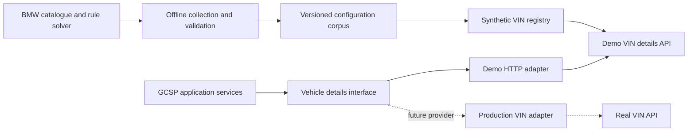

# Synthetic BMW fleet and replaceable VIN lookup

Refinement discussion, **1 November 2026**, for FUCQ-5 and the FUCQ-6 HLD. Russell proposed generating many BMW configurations through the configurator, assigning plausible invented VINs, storing the mappings in a stub database, and consuming a VIN lookup API through a replaceable adapter. He subsequently selected **10,000 genuinely distinct configurations**. Repeating one configuration under many VINs does not satisfy that target.

Russell subsequently **authorised two backlog epics**: structure/service/adapter plus the plausible VIN generator, followed by collection and population of the 10,000-configuration fleet. This remains a **research and backlog refinement only** session. No fleet generator, database, lookup API or application adapter has been implemented and no bulk collection has run. FUCQ-6 still owns the agreed HLD and deployment choices. The refined capability descriptions below are the source for [FUCQ-19](https://ibm-consulting.atlassian.net/browse/FUCQ-19) and [FUCQ-20](https://ibm-consulting.atlassian.net/browse/FUCQ-20). Jira is authoritative; its population description also names FUCQ-19 explicitly as the prerequisite.

## Recommendation and alternatives

Use an **offline collection and publication pipeline**, followed by a **local synthetic VIN service**. Collect and validate source configurations ahead of the demonstration; publish an immutable dataset; run the demo without depending on BMW availability. The application consumes a vehicle-details interface through a demo HTTP adapter. A future BMW or other production adapter maps its own payloads into the same consuming contract.

Two alternatives are less suitable for the requested outcome: making live configurator calls during every lookup would retain a network dependency and still require a fictional VIN mapping; manually inventing specifications would lose the source-backed option and technical-data evidence. A snapshot-backed VIN service combines real catalogue configurations with explicitly fictional vehicle identities.

The stub may be a module and indexed data files in the existing Node deployment. It does not require a separate database server or microservice deployment merely to establish the HTTP boundary. FUCQ-6 chooses the actual storage, packaging and route. Ten thousand entries alone do not justify a new infrastructure dependency. Keep large generated payloads and image collections in reproducible dataset artifacts with manifests rather than committing every binary to Git.

The canonical draw.io HLD must incorporate the selected design in FUCQ-6 before implementation. This discussion diagram does not mark any proposed component as built or replace that agreement.

## What is proved

The [website-key follow-up](bmw-interface-research.md#follow-up-public-website-key-replay) established native access to catalogue, option descriptions and technical data using the anonymous configurator's public application key.

A further small native probe exercised the actual configuration-generation path for the sampled GB `T5MJ` / `72HH` i5 Touring, order date `2026-11-01`, effect date `2027-01-05`:

| Configuration | Rule solver | Resolved selected elements | OTD technical data |
|---|---|---|---|
| Alpine White / Smoke White upholstery | 200, constructible | 48 (47 configuration options + 1 accessory), requested choices preserved | 200, 72 values, 5 seats |
| Black Sapphire / same upholstery | 200, constructible | 48 (47 configuration options + 1 accessory), requested choices preserved | 200, 72 values, 5 seats |
| Black Sapphire / same upholstery / towbar | 200, constructible | 49 (48 configuration options + 1 accessory), including selected `S03AC` | 200, 72 values, 5 seats |

The selected element counts include `SE000001`, which the retained source types as an accessory. The successful OTD query included that element; keep this request evidence while preserving the option/accessory distinction in the collector. These are catalogue selections, not verified fitted equipment.

An unsorted towbar seed returned 400, `RUL_B_1000`, with “Invalid request parameter: included-elements must be sorted”. Sorting the same seed succeeded. The collector must canonicalise request codes before calling BMW as well as deduplicate the resolved output afterward. This is parameter validation, not evidence that the towbar combination was incompatible.

[Retained probe evidence](evidence/fucq-4/configuration-generation-native-2026-11-01.json) excludes keys, rule-state/trace IDs and private VINs. Three accepted configurations prove a small generation path, **not** the availability of 10,000 distinct valid configurations, broad model coverage, bulk-service limits or native COSY access. Existing [catalogue image references](evidence/fucq-4/README.md) prove two paint renders; the new towbar variant has no additional visual-fidelity proof.

## Configuration collection at the requested scale

1. Declare catalogue context and model coverage. Discover actual market/model/AG mappings and available option definitions; relate scheme eligibility separately to the agreed October 2024 baseline. Current catalogue availability does not establish scheme eligibility or released supply. Do not describe a future-effect catalogue as a historical vehicle's verified build.
2. Sample broadly across derivatives, bodies, powertrains, paints, upholstery, wheels and useful equipment. Use deterministic coverage targets and seeds. An option-list Cartesian product proposes candidates; it does not establish valid cars.
3. Submit sorted candidates to the rule solver. Retain constructibility, requested/resolved identity and all resolved selected options. Detect solver-added/removed options and model/date fallback. Reject mismatched or incomplete results before enrichment; do not count an ignored requested feature as selected.
4. Deduplicate on the actual resolved model/configuration. Preserve market, locale, dates and full sorted options in snapshot lookup identity. VIN changes, code ordering, timestamps, source-version changes or different requests that resolve to the same configuration must not inflate the **10,000** count. Do not manufacture novelty by repeatedly fetching the same model/options at different dates.
5. Fetch configuration-specific OTD and representative imagery using the same resolved identity and complete options. Map evidenced meanings/units; unknowns remain unknown. Preserve image role and fidelity. Cosmetic or non-visible equipment changes do not automatically imply distinguishable pictures. Share identical image assets where appropriate without claiming extra visual fidelity.
6. Collect in bounded, checkpointed batches with caching, progress counts, timeouts and finite retries. Stop/back off on source access/rate failures; do not rotate around provider limits. Record failures and resume without changing already published records. Discovering fewer than 10,000 valid configurations within coverage/request budgets is a reported shortfall, never permission to pad the corpus with duplicates.
7. Publish a validated manifest atomically: dataset/schema version, source/catalogue context, generator seed/version, exact distinct count, coverage distribution, field completeness and artifact checksums. The demo reads the published artifact without live BMW calls.

The request volume is material. One rule solve plus one OTD retrieval for each of 10,000 accepted unique configurations is about **20,000 data requests** in a simple pipeline, before rejected/duplicate candidates, catalogue discovery or imagery. At an illustrative one request per second that portion alone takes about **5.6 hours**; this is arithmetic, not a verified BMW rate allowance or delivery estimate. A selected source, collection budget and image/view policy are therefore implementation inputs. Native COSY proof, source-use/retention conditions and representative image validation remain explicit work rather than assumed outcomes.

## Synthetic identity and data boundaries

Each initial vehicle receives its own stable internal `vehicleId`, synthetic VIN, `datasetId` and immutable link to one configuration snapshot. Publish at least one vehicle per distinct configuration, so the initial target is at least 10,000 VIN records linked to 10,000 configurations. Additional vehicles sharing a configuration may be added later, but do not help meet the unique-configuration target. Regeneration with the same seed/version reproduces the mapping; a newer catalogue snapshot cannot silently change what an existing VIN identifies.

VINs should be as plausible as possible under the [researched BMW VIN rules](synthetic-vin-rules.md): all five requested WMIs (`WBA`, `WBS`, `WBY`, `5UX`, `5YM`) represented by compatible vehicle types; evidence-backed market/model/era descriptor and plant profiles; correct year coding where applicable; exact check-digit calculation; and seeded random serials with registry-wide collision handling. Use exactly 17 uppercase permitted characters, no `I`, `O` or `Q`, and versioned format profiles. The official North American reference tables are not proved UK/RHD mappings. Never derive the corpus from Russell's supplied real VIN or reuse its identifying parts. A regex-valid identifier alone does not prove BMW-specific model, factory or year coding. Verify any claimed manufacturer-specific template independently; otherwise state the remaining semantic limitation. Do not invent a globally reserved BMW serial range or claim guaranteed non-collision with every real vehicle.

Russell subsequently authorised the [AutoTrader-to-VINwiki profile-research method](synthetic-vin-rules.md#uk-listing-and-vinwiki-observation-method) for UK gaps. A bounded pilot found one BMW 120 candidate and one plate-linked 220i Active Tourer candidate; both have position-ten `0` and matching checksum arithmetic. These are single observations with unresolved market/steering/year semantics, not enabled UK profiles. Shared substantiated WMI/type codes may inform a versioned profile; individual VINs, plates and serials must not enter the corpus or generator seeds. Research a small corroborating sample per selected profile rather than 10,000 real vehicles. The G61 and other-WMI UK mappings remain gaps.

Primary format sources, read 1 November:

- [UK-hosted 19/2011 text, Annex I Part B, section 2](https://www.legislation.gov.uk/eur/2011/19/annex/I/part/B/division/2/2020-01-31): three-character WMI, six-character VDS, eight-character VIS, final four numeric, excluded letters and no spaces.
- [EU 2021/535, consolidated 1 January 2025, Annex II Part 2 sections A/C](https://eur-lex.europa.eu/eli/reg_impl/2021/535/2025-01-01/eng): three-character WMI, five-character VDS, position-nine check digit and eight-character VIS. Its transition provisions distinguish new-type approval and later registration dates. These sources demonstrate why one universal US-style year/checksum assumption is unsuitable; they do not establish the applicable UK/BMW profile for every sampled derivative/year.

Store `identityKind: synthetic` and catalogue-versus-scenario provenance explicitly. The VIN-to-build association is fictional even where all catalogue facts were observed. A catalogue render remains a representative image. Scheme eligibility, points, availability, releases, reservations, allocations and employee usage observations stay in their respective scheme/scenario services, referencing `vehicleId`; the static VIN service does not fabricate those as decoded factory facts.

The demo provider resolves only its published dataset. A well-formed unknown VIN returns not-found. A missing record or service failure never triggers a real BMW/Driver's Guide/third-party lookup. Provider mode and synthetic identity must be enforced server-side across fallback and error paths, so switching a production adapter cannot accidentally submit the generated corpus to a real decoder.

## Consuming API and future replacement

The conceptual route is `GET /vehicles/{vin}` on the demo source, reached through a backend adapter. Its final prefix, hosting and access boundary belong to FUCQ-6. It is a lookup over a closed synthetic registry, not a public forwarding proxy for arbitrary real VINs.

Return a narrow versioned vehicle-details result: vehicle identity, configuration identity, model/body/powertrain, paint/upholstery, selected equipment, evidenced technical values with units, image references/fidelity, source dates, completeness and synthetic/source provenance. Keep invalid input, not-found, partial data, unsupported, source unavailable and identity mismatch distinguishable. The application consumes this normalised result; source-specific transport and field names stay inside the selected adapter.

Replacing the demo adapter with a production adapter contains integration changes. It does not guarantee a credential-only switch: the real provider still needs payload mapping, permission/access, coverage/completeness checks and error/retention handling. It may expose fewer facts or need a separate image source. The shared consumer must already handle partial/unknown data. Do not design an invented BMW response schema and claim production compatibility from the stub alone.

## Authorised bounded backlog capabilities

The user requested **two separate Epics**, created and read back on 1 November 2026, with the following split.

| Jira Epic | Outcome | Dependencies |
|---|---|---|
| [FUCQ-19](https://ibm-consulting.atlassian.net/browse/FUCQ-19) | Structure, plausible generator, closed VIN API and consuming adapter; small five-WMI fixture set | FUCQ-6, FUCQ-14 |
| [FUCQ-20](https://ibm-consulting.atlassian.net/browse/FUCQ-20) | 10,000 distinct configurations collected, assigned VINs, loaded and reconciled | FUCQ-19, FUCQ-15; FUCQ-14 transitively |

Both are unassigned **To Do** Epics with label `backlog`, default Medium priority and no points. Both relate to FUCQ-5; six issue links were verified in Jira readback. These are bounded outcomes spanning data, HTTP and the consuming adapter. FUCQ-14/15 remain foundations; FUCQ-16 remains the separate handbook/illustration capability. FUCQ-17/18 retain their existing live-access gates. No duplicate `_dev/` story files or implementation dispatch are created by this refinement.

### Look up synthetic BMW vehicles using plausible generated VINs

#### Goal

As a GCSP application consumer, retrieve a fictional BMW's stable source-backed configuration through an HTTP VIN lookup service and replaceable backend adapter, with a generator that produces the most plausible supported BMW identities.

#### Acceptance criteria

1. Deliver a closed synthetic registry with versioned configuration snapshots, stable `vehicleId`/`configurationId`/`datasetId`, immutable VIN associations, a repeatable loader and a narrow vehicle-details contract. Prove it end to end with a small representative fixture set covering **WBA, WBS, WBY, 5UX and 5YM**, each matched to its vehicle class. Full fleet collection belongs to the separate population epic.
2. Implement versioned evidence-bearing VIN profiles keyed by model/derivative, body/powertrain, market/steering context, model year or era, WMI, VDS, applicable year convention, allowed plants and serial shape. Use the research in `docs/gcsp/synthetic-vin-rules.md`. Record source/date and confidence; enable only supported combinations and reject unsupported/mismatched combinations. Preserve additional valid WMIs where represented models need them; do not force M2 into WBS or all EVs into WBY. Official US profiles are labelled reference fixtures and cannot silently identify GB/RHD configurations.
3. Generated identifiers have exactly 17 uppercase allowed characters, excluding I/O/Q. Calculate position-nine check characters exactly for supported checksum-bearing profiles using the documented transliteration, weights and modulo 11; remainder 10 becomes X. Apply evidenced year and model/era-to-plant rules. Model year, fictional production date, registration and catalogue dates remain distinct. Never impose US year/check rules on an incompatible historical European template.
4. Generate profile-constrained pseudorandom serials with a recorded seed and generator version, preserving leading zeros and required numeric tail positions. Check uniqueness across the registry, handle collisions deterministically within finite limits, and report exhaustion. Clean regeneration reproduces mappings; restart/resume, reordered input and later additions preserve published associations. No supplied real VIN or identifying fragments enter generation. Do not claim globally reserved numbers or guaranteed non-collision with real vehicles.
5. Expose actual HTTP lookup over the registry and consume it through a backend demo adapter. Normalise identity, model/body/powertrain, paint/upholstery, selected equipment, evidenced technical values/units, representative image references/fidelity, source dates and completeness. Keep source payload/storage names inside the adapter. A deliberately differently shaped offline provider demonstrates replacement behind the same consumer interface; this proves the boundary, not real BMW compatibility.
6. Define and verify canonical input handling and invalid, unknown/not-found, partial, unavailable, unsupported and identity-mismatch outcomes. Server-side routing preserves synthetic identity across failures and provider switches: **zero generated VINs are forwarded to BMW, Driver's Guide or any third-party real decoder**, including fallback paths. A regex or checksum alone cannot identify synthetic records.
7. Publish/load datasets atomically and verify referential integrity. Invalid loads leave the previous active version usable; identical reloads are idempotent; restart/reset does not reassign VINs. Preserve source-backed catalogue facts versus fictional VIN/build associations. Scheme eligibility, points, availability/releases, reservations, allocations and usage telemetry remain separate and refer to `vehicleId`.
8. The default runtime and tests work offline. The result includes run/load/API documentation and fixture evidence through the actual HTTP adapter. It must provide all presentation fields needed to show unknown data and representative imagery truthfully.

#### Files or areas

Synthetic identity/profile registry, generator and loader, versioned seed artifacts, demo HTTP lookup route, narrow vehicle-details contract, backend consuming adapter and offline integration/contract checks at FUCQ-6 agreed locations. Reuse the FUCQ-14 snapshot identity/provenance work and FUCQ-15 image contract where applicable; preserve existing used-car `stock.js`/`mapping.js` behaviour.

#### Decided

Russell authorised this epic on 1 November 2026 and required maximum plausible BMW VIN structure, all five requested WMIs, researched descriptors, correct check/year/plant coding and random final serials. Read this proposal, `synthetic-vin-rules.md`, `bmw-interface-research.md`, `demo-brief.md`, `experience-quality.md` and `COMPONENTS.md`. FUCQ-6 agrees the canonical HLD/storage/deployment path and FUCQ-14 supplies the snapshot foundation before implementation. The primary 2026/2027 BMW Part 565 tables establish North American references; UK/RHD coverage remains explicitly incomplete. There is no new screen or agreed GCSP visual reference: verify the backend presentation contract, provenance, units, missing values and error states. Every child inherits these obligations.

#### Out of scope

The 10,000-configuration collection/load run, real-provider credentials/integration, public real-VIN forwarding, claiming BMW-issued identities, new infrastructure beyond FUCQ-6's decision, changes to scheme policy/state or fabricated connected data.

#### Validate

Offline checks cover the regulation's public checksum vector and all remainder outcomes including X; profile/year/plant/serial mismatches; every required WMI; uniqueness/collisions/exhaustion; deterministic rebuild, reordering, resume and additions; immutable identity and atomic/idempotent load/recovery. HTTP integration checks cover complete, partial, invalid, not-found, unavailable and mismatched responses, plus mapping from an alternative offline provider. Instrumented transport assertions verify zero real-provider calls for synthetic identities across normal/error/fallback/provider-switch paths. Contract evidence checks image fidelity, unknown values and synthetic/source labels. Consuming UI stories supply browser/screenshot evidence against the visual reference when agreed.

### Populate the demo VIN service with 10,000 distinct BMW configurations

#### Goal

As a demo scenario author, collect 10,000 genuinely different BMW configurations, assign stable plausible synthetic VINs using the structure/generator capability, and publish them into the working lookup service so the demonstration runs offline.

#### Acceptance criteria

1. Declare model/derivative/body/powertrain coverage, source provider, market/locale, model/catalogue dates, bounded request and image budgets, seed and generator/profile versions before collection. Use a documented supported profile for every represented derivative; close selected UK/RHD descriptor/year/plant gaps rather than apply US codes silently. Cover **multiple distinct configurations under each of WBA, WBS, WBY, 5UX and 5YM**, with planned/actual distributions and explicit exclusions. Additional valid WMIs are allowed when required by the selected models. Current catalogue evidence does not redefine the October 2024 eligibility baseline.
2. Implement offline dry-run planning and bounded resumable collection. Discover real model/AG mappings and selectable options. Submit sorted option candidates to the rule solver, retain the complete resolved selection and constructibility, detect added/removed/ignored requested options and model/date substitutions, and reject inconsistent/incomplete results. An unvalidated Cartesian product cannot count as vehicles.
3. Publish **10,000 genuinely distinct complete resolved configurations**. Canonical resolved model/body/powertrain/options determine distinctness; VIN changes, requested choices resolving identically, option order, dates/timestamps, metadata or source-version aliases cannot pad the count. Preserve full market/date context for source identity without counting repeated model/options as novelty. A shortfall remains incomplete with a resumable checkpoint and a report.
4. Enrich each accepted configuration using matching resolved identity and full options with configuration-specific technical data and the agreed representative-image coverage. Preserve meanings/units, selected versus available equipment, missing values, source context, image roles and fidelity. Share identical assets where appropriate. Extend/reuse FUCQ-14/FUCQ-15 rather than duplicate their contracts or claim that every option creates a visibly different image.
5. Collect with caching, checkpoints, finite retries, timeouts, conservative concurrency and stop/backoff on source access/rate failures. Record actual request counts, failures, resolved duplicates and coverage progress. Source access, retention, quotas and unsupported public-website dependencies are explicit run inputs. Bulk calls never start implicitly in CI or during a normal demo lookup.
6. Use the first epic's generator/loader to create **at least 10,000 vehicle/VIN records, one for each distinct configuration**, and load/reconcile them into the actual registry. Preserve all earlier published associations; detect VIN collisions across datasets. Configuration and vehicle counts, checksums and every reference reconcile with the published manifest. Repeating a configuration under more VINs does not satisfy the configuration target.
7. Atomically activate a versioned dataset with exact distinct count, WMI/model/option coverage, completeness, source/catalogue context, seed/tool versions and artifact checksums. Interrupted collection or failed validation/load leaves the previous active dataset usable. Resume, clean rebuild, idempotent reload and reset produce the documented stable identities. Keep large payloads/images as reproducible artifacts at the agreed location.
8. Demonstrate actual HTTP lookups through the consuming adapter for every required WMI and a representative selection of derivatives/options, including towbar, paints, upholstery and missing-data/image cases where present. Registry enumeration/reconciliation verifies all records; a batch or bounded concurrency check over the 10,000-record dataset supplies measured lookup behaviour and correctness. Offline runtime makes zero BMW/decoder calls, and synthetic/source provenance survives every result. Scheme stock/events/points and telemetry stay outside the static VIN dataset.

#### Files or areas

Resumable collection/enrichment tooling, canonical configuration keys, coverage/profile plan, publication manifests/artifacts, generator/registry integration, reconciliation/verification reports and runbook at FUCQ-6 agreed locations. Reuse the structure/generator epic and FUCQ-14/FUCQ-15 contracts.

#### Decided

Russell selected **10,000 genuinely distinct configurations** and authorised this separate population epic on 1 November 2026. Read this proposal, `synthetic-vin-rules.md`, `bmw-interface-research.md`, `demo-brief.md`, `experience-quality.md` and `COMPONENTS.md`. The three-configuration native pilot proves sorted rule-solver/OTD generation for one GB i5 Touring; it does not prove 10,000-config availability, broad model coverage, quotas or a UK VIN dictionary. Agree the FUCQ-6 HLD and selected source/coverage/image/request context before the bulk run. No new screen or GCSP visual reference is introduced: verify provenance, representative imagery, unknown values and failure outcomes at the presentation contract; propagate these requirements to descendants.

#### Out of scope

Building a second VIN service/adapter/generator, live BMW calls during the demo, production VIN integration, replacing scheme eligibility with the current catalogue, allocation/availability policy or invented usage telemetry.

#### Validate

Default checks use offline fixtures for sorted options, solver mutations, substitutions, semantic duplicates/date aliases, completeness/units, interruption/resume, finite retries and atomic publication/load recovery. The expressly selected live run must supply the actual 10,000-distinct manifest, coverage/completeness report, source request counts and retained artifact checksums. Reconcile every configuration/vehicle/VIN and checksum/profile constraint; prove idempotent reload and stable published mapping. Inspect representative image associations across collected model/paint/body coverage and record fidelity limits. Exercise actual HTTP adapter lookups on the loaded dataset and report measured lookup behaviour; instrument runtime outbound transport to assert zero live BMW/decoder calls. No arbitrary unagreed latency target is introduced by this refinement.

## Review and remaining choices

Independent read-only reviews requested Opus, selected `gpt-6.1-sol` / `high`, no fallback or descendants; effective runtime settings unverified. The final review passed the authorised two-epic split and verified all 41 cited MY2026 descriptors, 145 reference rows, filing counts and year codes against retained evidence. It found no blocking or major issue. All live research stayed in the main session.

The count and two-epic split are agreed. Remaining implementation inputs are the supported derivative/UK VIN profile coverage, catalogue contexts, image/view coverage, collection budgets/source activation and FUCQ-6 storage/deployment placement. The [VIN rules research](synthetic-vin-rules.md) records the primary evidence and unresolved UK mappings. These inputs do not justify substituting repeated configurations for Russell's chosen target.
